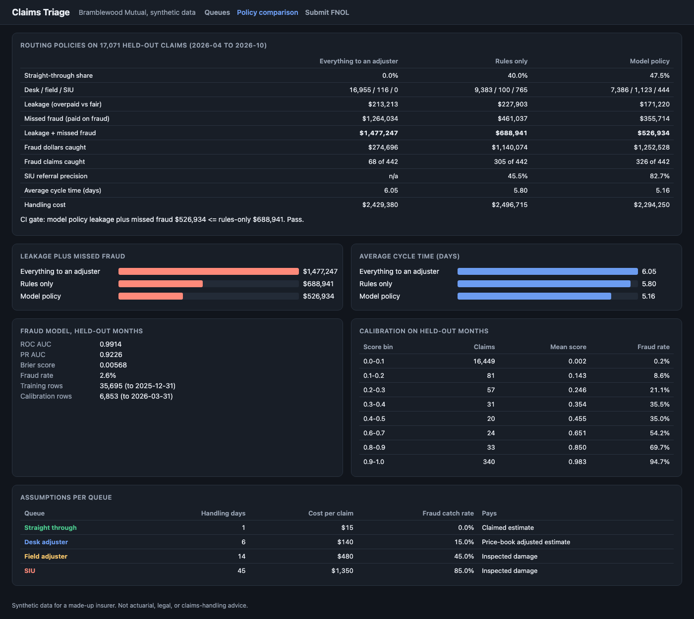
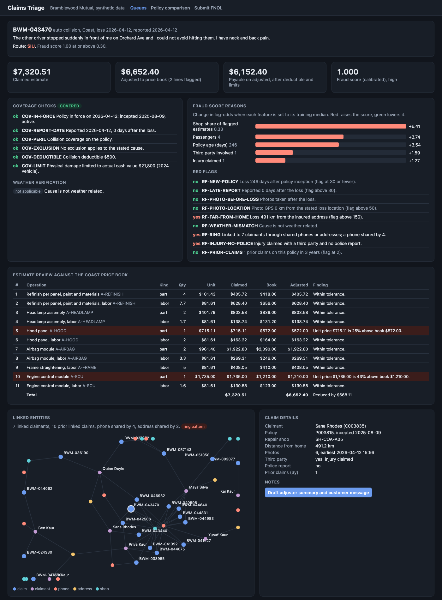

# Claims Triage

First notice of loss (FNOL) triage for Bramblewood Mutual, a made-up personal auto and home insurer. Every new claim runs through coverage rules, an estimate review against a regional price book, weather verification, a shared entity network, red-flag rules, and a calibrated fraud model. A routing policy in YAML then decides whether to pay it straight through, send it to a desk adjuster, send a field adjuster, or refer it to the special investigations unit (SIU). The policy is evaluated on held-out months for leakage, fraud caught, and cycle time, against two baselines.



## Results

Default run: 59,619 synthetic claims reported November 2024 to October 2026, seed 42. Held-out test set: 17,071 claims reported April to October 2026. The model never saw these months during training, calibration, or threshold tuning.

| | Everything to an adjuster | Rules only | Model policy |
|---|---:|---:|---:|
| Straight-through share | 0.0% | 40.0% | 47.5% |
| Desk / field / SIU | 16,955 / 116 / 0 | 9,383 / 100 / 765 | 7,386 / 1,123 / 444 |
| Leakage (overpaid vs fair) | $213,213 | $227,903 | $171,220 |
| Missed fraud (paid on fraud) | $1,264,034 | $461,037 | $355,714 |
| **Leakage + missed fraud** | **$1,477,247** | **$688,941** | **$526,934** |
| Fraud dollars caught | $274,696 | $1,140,074 | $1,252,528 |
| Fraud claims caught | 68 of 442 | 305 of 442 | 326 of 442 |
| SIU referral precision | n/a | 45.5% | 82.7% |
| Average cycle time (days) | 6.05 | 5.80 | 5.16 |
| Handling cost | $2,429,380 | $2,496,715 | $2,294,250 |

Against rules only, the model policy pays 7.5 more points of claims straight through, cuts leakage plus missed fraud by $162,000 (24%), and sends 42% fewer claims to SIU while raising SIU precision from 45% to 83%. Fraud model on the test months: ROC AUC 0.991, PR AUC 0.923, Brier 0.0057, on a 2.6% fraud rate. By fraud type, the model routes 100% of staged ring claims, 90% of weather claims with no matching storm, and 79% of prior damage claims to field or SIU.

These numbers depend on the assumptions per queue in `config/routing.yaml` (handling days, cost, and the share of fraud each queue catches). They are illustrative. This is synthetic data and not actuarial or claims-handling advice.

## Why

Most personal lines claims are small and honest, and making every one wait for an adjuster costs the insurer money and the customer days. Paying claims straight through is fast, but every dollar paid on a padded estimate or a staged accident is leakage. A triage engine has to make that trade explicitly: clear coverage rules, a price check on every estimate line, fraud signals that look at the network of people, phones, addresses, and shops (rings are invisible one claim at a time), and a routing policy whose thresholds are configuration, not code. Then it has to prove, on months it never saw, that it pays less leakage and catches more fraud than the rules it replaces.

## Architecture

```
 synthetic book (seeded)           claim processor (same code for batch and live FNOL)          routing + evaluation
 ┌─────────────────────────┐   ┌──────────────────────────────────────────────────────────┐   ┌──────────────────────────┐
 │ ~60,000 claims, 2 years │   │ coverage rules: in force, peril, exclusions, deductible, │   │ config/routing.yaml      │
 │ policies, claimants,    │──▶│   limits, jewelry sublimit, percent wind deductible      │──▶│ stp / desk / field / siu │
 │ line item estimates,    │   │ estimate review vs regional price book: parts, labor     │   │ with reasons             │
 │ photo metadata, shops,  │   │   rate, hours, unexpected or duplicate operations        │   │                          │
 │ hail storm + flood,     │   │ weather check: hail and flood vs event table             │   │ held-out evaluation:     │
 │ rings, ground truth,    │   │ entity network (union-find, history only)                │   │ leakage, missed fraud,   │
 │ fair settlement         │   │ red flags (9 rules)                                      │   │ SIU precision, cycle     │
 └─────────────────────────┘   │ fraud model: gradient boosting + Platt calibration,     │   │ time, handling cost      │
                               │   occlusion explanations                                 │   │ CI gate vs rules-only    │
                               └──────────────────────────────────────────────────────────┘   └──────────────────────────┘
                                                        │
                                  FastAPI: POST /api/fnol, claim detail, queues, evaluation, notes (template or Claude),
                                  audit trail (SQLite, append-only), /healthz, /metrics, JSON logs, plain JS UI at /
```

| Piece | File |
|---|---|
| Regions, price book, perils, coverage terms | `src/claimstriage/catalog.py` |
| Synthetic claims book, weather events, rings, ground truth | `src/claimstriage/synth.py` |
| Coverage rules, deductible and limit math | `src/claimstriage/coverage.py` |
| Estimate review against the price book | `src/claimstriage/pricebook.py` |
| Weather verification | `src/claimstriage/weather.py` |
| Shared entity network, ring detection, ego graph | `src/claimstriage/network.py` |
| Red-flag rules | `src/claimstriage/redflags.py` |
| One processor for history and live FNOL, features | `src/claimstriage/pipeline.py` |
| Fraud model, time split, calibration, explanations | `src/claimstriage/model.py` |
| Routing policies (model, rules only, all adjuster) | `src/claimstriage/routing.py` |
| Payment model and policy evaluation | `src/claimstriage/evaluate.py` |
| Batch job and threshold tuning | `src/claimstriage/batch.py` |
| Claim notes (template, Claude) | `src/claimstriage/notes.py` |
| API, service, store, metrics, logs, UI | `app.py`, `service.py`, `store.py`, `metrics.py`, `logs.py`, `static/index.html` |

Details worth knowing:

- **Ground truth.** Each claim is legitimate, inflated (padded prices or hours, duplicate or extra operations), or fraudulent (staged ring accident, prior damage on a new policy, or a hail or flood claim with no matching storm). The fair settlement is the true damage after the deductible and limits under the true cause, and zero for fraud. Labels and fair amounts are used only to train and evaluate. The API never returns them, which a test checks.
- **Payment model.** Straight through pays the claimed estimate. A desk adjuster pays the price-book adjusted estimate, so padding the book can see is removed but a plausible extra operation is not. Field and SIU inspect the damage and pay the true amount. Each queue catches fraud at an assumed rate (0%, 15%, 45%, 85%), using one random draw per claim shared by all policies, so the comparison is paired.
- **No leakage in time.** Network and shop features come from a union-find index that processes claims in report order and reads its state before adding each claim. A test deletes every claim after a cutoff, reprocesses, and checks the features of earlier claims are identical. Train is November 2024 to December 2025, calibration is January to March 2026, test is April to October 2026.
- **Thresholds.** `claimstriage tune` grid searches the model policy's score and variance thresholds on the calibration months only. The values in `config/routing.yaml` came from that search: the top result has a straight-through score cutoff of 0.01, and 0.02 is within $500 of it with 0.4 points more straight-through payment, so the config uses 0.02.
- **Rings vs households.** Claimants link through shared phones, shared addresses, and third-party phones. A component with 4 or more claimants, or a phone shared by 3 or more, is a ring flag. Households (up to 3 people at one address) are not. Repair shops are not graph links, since popular shops would join everything. They enter as concentration features: share of a shop's prior claims that were linked or had flagged estimates.
- **Explanations.** For each claim, every feature is set to its training median in turn and the change in log-odds of the calibrated score is reported. Log-odds keep the reasons readable when the score is near 0 or 1.
- **Notes.** The default provider is an offline template. The Claude provider (`CT_NOTES_PROVIDER=claude`, model `claude-opus-5-5`, `anthropic` imported lazily) gets computed facts only, never raw claimant data. The customer message must not mention fraud, scores, or investigations: the prompt says so, and any reply that does is replaced with the template message.

## How to run

Requires [uv](https://docs.astral.sh/uv/). Docker is optional.

```bash
make install                          # uv sync --python 3.12
uv run claimstriage all               # generate, process, train, route, evaluate: about 80 seconds
make run                              # API and UI on http://127.0.0.1:8834
```

Other commands:

```bash
uv run claimstriage all --claims 20000 --seed 7   # smaller or different book
uv run claimstriage evaluate                       # print the policy comparison from the last run
uv run claimstriage gate                           # exit 1 if the model policy loses to rules only
uv run claimstriage tune                           # threshold search on the calibration months
```

Submit an FNOL from the command line (the sample uses a real synthetic policy):

```bash
curl -s localhost:8834/api/fnol/sample > fnol.json
curl -s -X POST localhost:8834/api/fnol -H 'content-type: application/json' -d @fnol.json
```

The response has the coverage result, adjusted estimate with flagged lines, fraud score with reasons, red flags, weather result, linked entity graph, and route with reasons. Try raising a unit price or moving `photos.exif_min` before the loss date and the claim leaves the straight-through queue.

Endpoints: `POST /api/fnol`, `GET /api/claims/{id}`, `POST /api/claims/{id}/notes`, `GET /api/queues`, `GET /api/queues/{stp|desk|field|siu}`, `GET /api/evaluation`, `GET /api/audit`, `GET /healthz`, `GET /metrics`.

With Docker: `docker compose up --build` runs the batch job into a shared volume, then starts the API. The Docker files are built and smoke tested in CI, not on this machine (Docker is not installed here).

Screenshots: with the server running, `make screenshot` drives headless Chrome to write `docs/screenshot.png`, `docs/claim-detail.png`, and `docs/queues.png`.



## Tests

```bash
uv run pytest -q       # 96 tests, about 25 seconds
uvx ruff check .
```

- Coverage (19): in force, cancellation before and after the loss, collision vs comprehensive, flood endorsement, gradual leak exclusion, unknown water source as a question, deductibles (collision, comprehensive, 1% wind and hail), actual cash value limit, jewelry sublimit, denied pays zero.
- Price book (9): regional parts multiplier and labor rate, tolerance edges, padded parts, labor rate, excess hours, operations not expected for the peril, duplicates.
- Red flags and weather (13): each rule fires and its near miss does not; weather verified inside an event, the 2-day window, wrong place, wrong kind.
- Network (8): ring vs household, third-party phone links, missing values never link, history only, shop counts, batch ring detection, ego graph.
- Model, routing, evaluation (25): every routing threshold edge, config-driven thresholds, rules-only and all-adjuster baselines, accounting on a hand-built frame (leakage, missed fraud, caught dollars, cycle time, cost), splits ordered in time, network features unchanged when future claims are deleted, calibration, explanations, deterministic paired evaluation.
- Synthetic data (6): same seed same data, label mix, fraud fair amount is zero, inflated estimates exceed true damage, rings share entities, the hail storm produces claims.
- API end to end (16): health, metrics, UI, queues sorted, 404s, claim detail with no ground truth, FNOL submit then detail, queue, and audit, a padded FNOL with old photos leaves straight through, validation (400 and 422), notes with audit, append-only audit table, Claude provider against a fake client (model id, facts only, leak guard, malformed replies), default provider never imports `anthropic`.

The tests build their own 8,000-claim book. That set has about 60 held-out fraud claims, too few for the rules-only comparison to be stable, so the leakage gate runs at full size in CI.

CI (`.github/workflows/ci.yml`): lint and tests; a **leakage gate** job that runs the full 60,000-claim pipeline and fails if the model policy's leakage plus missed fraud on held-out claims exceeds the rules-only baseline; and a Docker job that builds the image, runs the batch job in a container, and smoke tests health, a queue, an FNOL submit, and metrics.

## Production notes

- Fraud labels come from SIU outcomes months after the claim, and only for referred claims. Training would wait for labels to mature and correct for selection bias, for example with a small random audit sample of straight-through claims.
- The price book would be a licensed parts and labor database by ZIP code, and photo review would use a damage estimation model, not just metadata.
- Weather would come from a hail and flood data provider with swath polygons, not a circle around a center point.
- Entity resolution would need fuzzy matching on names, addresses, VINs, and devices, plus cross-carrier data from an industry fraud bureau.
- Routing thresholds would be set with the claims and SIU teams against queue capacity, with every change versioned, reviewed, and shadow tested before release.
- The customer message would go through a template and compliance review for each state, and adjusters would sign in through SSO with the audit trail on write-once storage.

## License

MIT. See [LICENSE](LICENSE).
